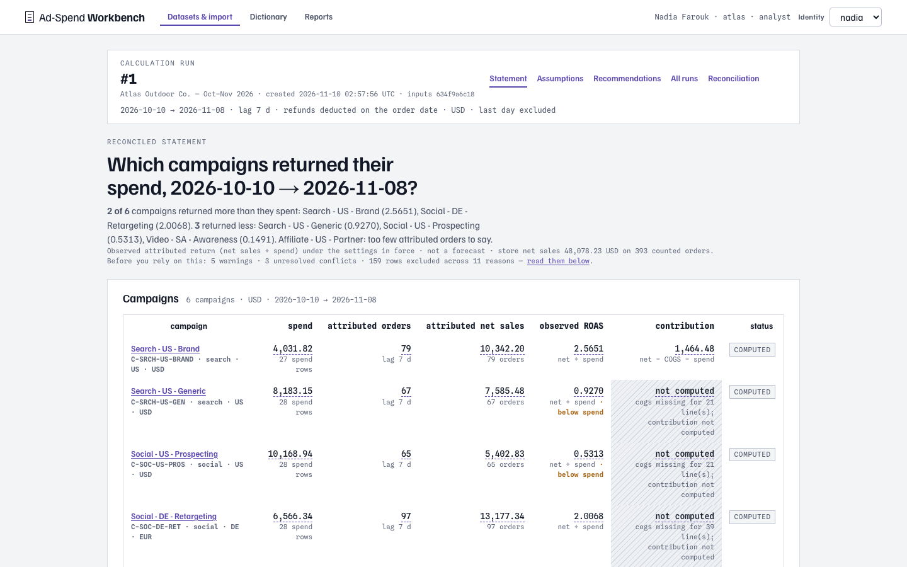

# Ad-Spend Decision Workbench

**Follow the money before following the metric.**

An attractive performance metric can hide bad inputs or weak margins. Ad-Spend Decision Workbench reconciles spend and order data before producing a recommendation.

Built by **Mohammed Abumtary** · TypeScript · React · Hono · PostgreSQL · decimal calculations · CSV provenance

[Demo guide](docs/DEMO.md) · [Engineering notes](docs/ENGINEERING.md) · [Verification & boundaries](docs/VERIFICATION.md) · [Recorded walkthrough](media/walkthrough.mp4)

## The experience

Reconcile inputs → inspect margin → compare scenarios → review the narrative.

CSV and synthetic campaign data. No advertising accounts are connected and no budget changes are executed.

## Where the engineering matters

### Reconcile before calculating

Import mappings and inconsistent rows remain visible before metrics are computed.

### Keep formulas inspectable

Decimal arithmetic, row provenance and explicit assumptions support drill-down from a metric to the inputs that produced it.

### Check the narrative against the numbers

A generated explanation is validated against calculated facts. Review and report export remain separate from any real spending action.

## Verified in the demonstration

- 14 database regressions and 19 browser checks passed in the current verification pass.
- The synthetic corpus spans six campaigns, three countries and ten edge cases.
- Recorded reconciliation, metric drill-down, assumption comparison and recommendation review.

## Explore the work

This repository is a presentation package: screenshots, walkthrough media and engineering notes. Application source, credentials and customer records are not included. The interactive demonstration runs in a separate local review environment; access can be arranged for a walkthrough.

[Read the guided demo](docs/DEMO.md) · [View my portfolio](https://mohammed-ab.github.io/)

## Scope

A controlled decision-support demo, not financial advice or a prediction of campaign returns. No automatic ad-platform writes exist in the showcased flow.

Reviewed 10 November 2026. Results describe the recorded build and stated test scope.
